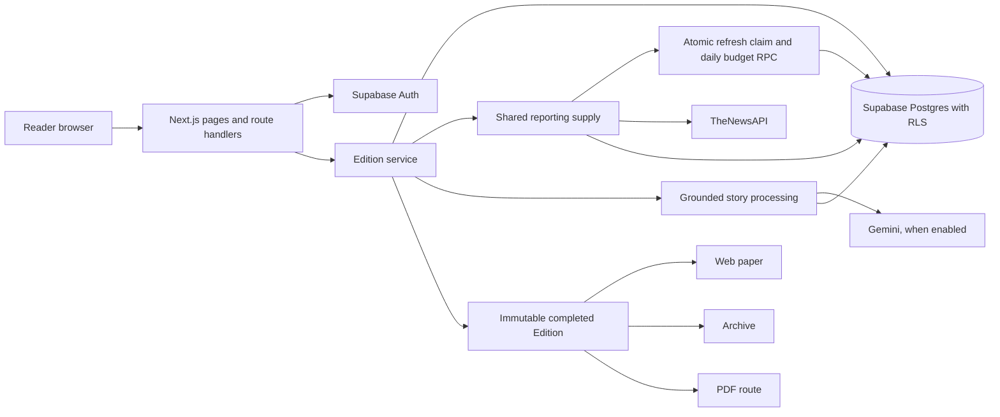

# Herald architecture outline

## Request path

## Boundaries and data ownership

- Next.js server pages and route handlers authenticate each reader with Supabase Auth. Reader preferences, feedback, Editions, and Edition Stories remain protected by row-level ownership policies.
- `getOrCreateDailyEdition` is the orchestration boundary. It returns a completed Edition for the reader's local day, or creates one from shared source reporting and the reader's stored preferences. Failed or empty generation does not create a completed Edition.
- `getReportingSupply` reads a shared 48-hour reporting cache. Before live refresh, it requests an atomic database claim that reserves five provider requests and enforces a 15-request UTC-day cap. A refresh lock coalesces concurrent readers; expired locks can be reclaimed. Each request has a ten-second timeout. Malformed responses are discarded.
- `processGroupedStories` sends source material without reader identity or preferences. Gemini output is schema and evidence checked, then cached by content hash. Missing, malformed, timed-out, or unusable output falls back to publisher excerpts/headlines and source links.
- Completed Edition Stories preserve their text, dates, publisher attribution, source URLs, section placement, and source links. The paper, archive, and PDF read those snapshots; those paths do not regenerate provider content.
- If fresh supply is unavailable, the service returns the most recent completed Edition with its stored date and a fallback marker. If no Edition exists, the reader sees an unavailable state with Retry.

## Operational dependencies

- Apply the SQL migrations in `supabase/migrations` before deploying code that depends on their columns or RPCs.
- Runtime news and AI credentials stay server-side. Gemini remains disabled until the audience and geography suitability decision in `docs/setup/slice-01.md` is resolved.
- The architecture describes implemented code paths. It does not establish deployed migration state, provider entitlement, live OAuth acceptance, or a production smoke result.
