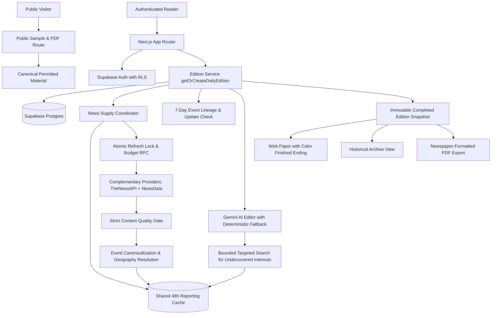

# Herald architecture outline

## Request path

## Boundaries and data ownership

- **Authentication & RLS Isolation:** Next.js server pages and route handlers authenticate each reader via Supabase Auth. Reader preferences, feedback, and Editions remain protected by Postgres Row Level Security (RLS). Direct public write to source reporting, editions, and feedback is denied (code 42501).
- **Public Pre-Login Samples:** Public visitors can inspect `/sample` and download matching `/api/editions/sample/pdf` without authentication. Public samples are built from permitted, validated material with explicit sample labelling and zero reader PII.
- **Orchestration & Immutability:** `getOrCreateDailyEdition` is the core orchestration boundary. It returns an immutable completed Edition for the reader's local day, or creates one from shared reporting supply, 7-day event lineage, and reader preferences. Once saved, an Edition is never modified on re-reading, archive view, or PDF export.
- **Complementary Shared Supply:** `getReportingSupply` reads a shared 48-hour reporting cache. Refresh operations acquire an atomic database lock token and enforce daily provider call caps to coalesce concurrent readers. Articles undergo strict quality filtering (rejecting feeds, non-article index pages, empty descriptions, or non-English content).
- **Event Deduplication & Lineage:** The system recognizes multiple provider stories covering the same real-world event. Unchanged events from the last 7 completed editions are deprioritized, while genuine developing updates carry clear explanation labels. Skip remains neutral.
- **Validated AI Editor & Bounded Search:** Minimal outbound context (topics, subtopics, coarse region) is sent to the Gemini AI editor; reader identity, email, exact location, raw history, and credentials never leave the system. A candidate shortlist (2x budget) is evaluated, with automatic deterministic fallback if AI is disabled or fails. If a declared interest is undercovered, bounded targeted search executes up to 2 calls with 1-hour cache coalescing.
- **Calm Finite Reading:** The signed-in paper features a compact dated header displaying actual duration versus budget (`~X min read (Y min plan)`), complete story contracts (title, briefing, why it matters, source provenance), Beyond Your Bubble discovery, wire context sidebar without unmeasured hype labels, and an `#edition-end` finish with PDF download button and archive links.

## Operational dependencies

- **Database:** Supabase Postgres with applied migrations in `supabase/migrations/` (`source_articles`, `editions`, `edition_stories`, `reader_preferences`, `story_feedback`, and ingestion RPCs).
- **Environment:** Production credentials (`SUPABASE_SERVICE_ROLE_KEY`, `THENEWSAPI_API_KEY`, `NEWSDATA_API_KEY`, `GEMINI_API_KEY`) remain strictly server-side.
- **Offline / Degradation Continuity:** Saved editions, archive views, and PDF exports are entirely provider-independent once stored in Postgres. Provider outages serve preserved saved-date fallbacks or honest shortages without corrupting data.
